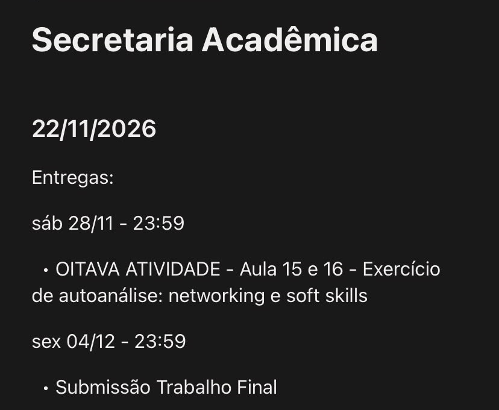
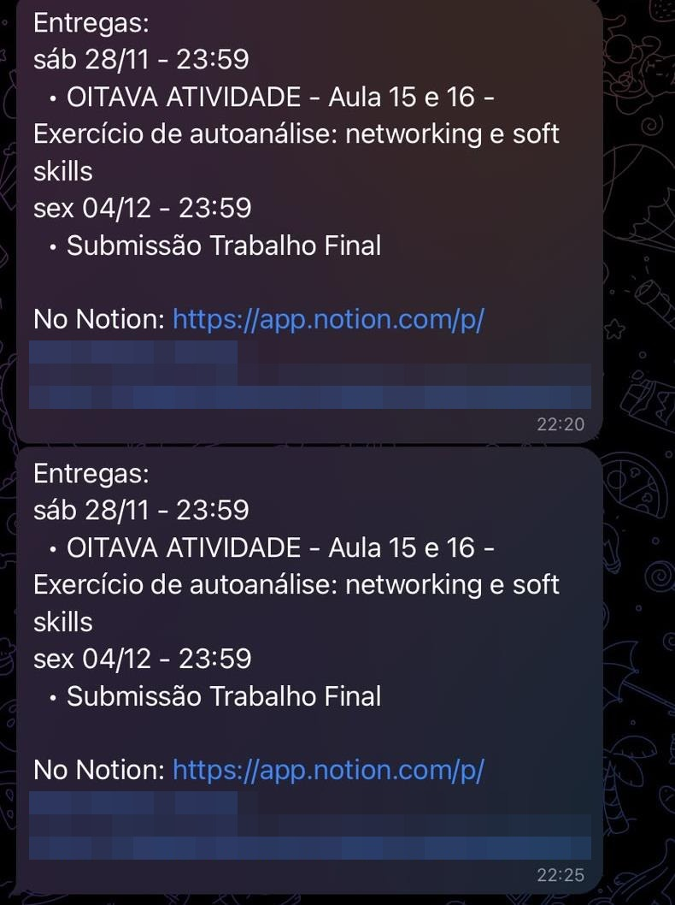

# Secretaria Acadêmica

Lê os prazos do calendário do Blackboard/SENAC, monta um resumo diário,
publica no **Notion** e envia o link no **Telegram**.

> Projeto Final 2 - Automação e Programabilidade em Redes (Prof. Me. Wagner Loch)
> Autor: **Yuri G.M** (Turma Noite)
> Apresentação: **27/11/2026**. Entrega: **04/12/2026 às 23:59**

## 1. Sobre o projeto e problema resolvido

Os prazos ficam espalhados no calendário do Blackboard e é fácil perder uma
entrega. A automação junta o que vence nos próximos 30 dias, guarda o histórico
no Notion e avisa no Telegram. Depois de configurada, roda sozinha todo dia às
08:00, sem abrir o Blackboard.

## 2. Arquitetura e fluxo de funcionamento

```
cron 08:00
  -> coletar()             baixa e lê o feed ICS do Blackboard
  -> filtrar()             mantém os prazos dos próximos 30 dias
  -> montar_resumo()       agrupa os prazos por dia
  -> salvar_json()         grava prazos.json
  -> publicar_no_notion()  atualiza a página única e devolve o link
  -> enviar_telegram()     envia o resumo com o link
```

O Notion vem antes do Telegram porque a mensagem leva o link da página.

A página é uma única página, chamada `Secretaria Acadêmica`, com uma seção por dia
identificada pela data (`dd/mm/aaaa`). A seção mais recente fica no topo:
rodar de novo no mesmo dia substitui a seção daquele dia, e um dia novo entra
no topo sem apagar os anteriores.

O feed traz apenas título e data, e é isso que o resumo mostra: sem LLM, sem
scraping e sem login automatizado. Se a coleta falhar, o script registra o
motivo e sai com código 1, sem enviar prazo fictício.

## 3. Tecnologias e APIs utilizadas

| Tecnologia | Uso |
|---|---|
| Python 3 | linguagem do projeto |
| `requests` | HTTP para Blackboard, Notion e Telegram |
| `python-dotenv` | leitura do arquivo `.env` (opcional) |
| Blackboard (feed ICS) | fonte dos prazos |
| Notion API (páginas e blocos) | destino do resumo |
| Telegram Bot API (`sendMessage`) | aviso final |
| JSON | respostas das APIs e arquivo de saída `prazos.json` |
| cron | gatilho diário |

Toda requisição tem `timeout` e verificação de status.

## 4. Pré-requisitos e como executar

Pré-requisitos: Python 3.8 ou superior, `pip`, `git` e um link ICS do
calendário. As credenciais ficam no `.env`, criado a partir do `.env.example`.

### Linux (Debian, Raspberry Pi 3B+)

```bash
git clone https://github.com/YuriMine/secretaria-academica.git
cd secretaria-academica
python3 -m venv .venv
source .venv/bin/activate
pip install -r requirements.txt
cp .env.example .env
python3 secretaria.py --simular
python3 secretaria.py
```

Se o Debian não tiver o módulo `venv`, instale antes:

```bash
sudo apt install python3-venv
```

### Windows (PowerShell)

```powershell
git clone https://github.com/YuriMine/secretaria-academica.git
cd secretaria-academica
python -m venv .venv
.\.venv\Scripts\Activate.ps1
pip install -r requirements.txt
copy .env.example .env
python secretaria.py --simular
python secretaria.py
```

Em ambos os casos, preencha as 5 variáveis no `.env` antes de rodar. O
`--simular` só imprime o resumo; o comando sem argumento publica no Notion e
envia a mensagem no Telegram.

Agendamento (cron, todo dia às 08:00):

```cron
0 8 * * * cd /caminho/secretaria-academica && TZ=America/Sao_Paulo .venv/bin/python secretaria.py >> execucao.log 2>&1
```

O `TZ=` afeta apenas o horário usado pelo script (`datetime.now()`). A hora em
que o cron dispara depende do fuso do sistema. Para defini-lo:

```bash
sudo timedatectl set-timezone America/Sao_Paulo && sudo systemctl restart cron
```

## 5. Demonstração (resultados)

Execução real em 22/11/2026: o script leu o feed, atualizou a página no Notion e
enviou o resumo no Telegram.

**Página única no Notion**, dentro da página-mãe `4 - SECRETÁRIA-ACADÊMICA`, com
a seção do dia no topo:



**Mensagem recebida no Telegram**, com o resumo e o link da página:



O print mostra duas execuções no mesmo dia: a segunda substituiu a seção
daquele dia, sem criar outra página. O identificador da página foi desfocado na
captura de tela por segurança; ele não é necessário para conferir o resultado.

## 6. Melhorias futuras (roadmap)

1. Aviso de arquivo novo, por e-mail (IMAP).
2. Janela de dias configurável (`JANELA_DIAS`).
3. Testes automatizados com `unittest` e GitHub Actions.

## Estado atual

| Item | Estado |
|---|---|
| Fluxo, Notion e Telegram | validados com o feed real e em produção |
| Cron | ativo, todo dia às 08:00 |
